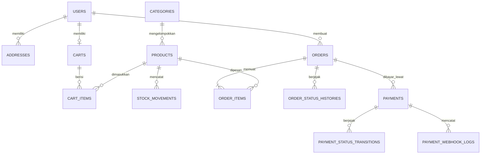

# Spesifikasi Database Baru (Greenfield)

> **Kebijakan Pemilik Proyek:** Untuk database proyek baru, **ambil/buat database yang benar-benar baru**. Tidak ada kewajiban mempertahankan file SQLite lama, riwayat migrasi `iraweb`, atau data simulasi/eksperimental sebelumnya.

---

## 1. Perbandingan dengan Skema `iraweb` Lama

Pada baseline `iraweb`, terdapat beberapa hal yang tidak lagi relevan dan justru membebani skema baru:
1. **Tabel khusus simulator/developer:** `developers`, `simulation_runs`, `simulation_audit_logs`.
2. **Metadata simulasi di hampir setiap tabel:** kolom `origin` (`normal` / `developer_simulation`), `simulation_run_id`, `is_simulated`, beserta `CHECK (origin = 'normal' OR simulation_run_id IS NOT NULL)`.
3. **Lock-in simulator di tabel `payments`:** `CHECK (provider = 'simulator')`, `CHECK (is_simulated = 1)`, `payment_token` khusus `/pay/sim/{token}`.
4. **Raw SQL khusus SQLite:** `CREATE TABLE ... AUTOINCREMENT` dan `where raw` di migrasi `000004`–`000016` yang menyulitkan jika proyek baru ingin memakai MySQL/MariaDB atau PostgreSQL.

---

## 2. Pilihan Mesin Database & Prinsip Migrasi

Pada proyek baru, migrasi sebaiknya ditulis ulang secara bersih menggunakan **Laravel Schema Builder** standar (`Schema::create(...)`) agar portabel baik untuk **SQLite baru** maupun **MySQL/MariaDB baru**:

- **Opsi 1 — SQLite Baru (`DB_CONNECTION=sqlite`):**  
  Cocok untuk pengembangan cepat dan scope kecil tanpa setup server DB terpisah. Buat file baru dari nol (`database/database.sqlite`) saat tahap setup.
- **Opsi 2 — MySQL / MariaDB Baru (`DB_CONNECTION=mysql` / `mariadb`):**  
  Cocok jika ingin memakai server DB lokal (mis. XAMPP/MySQL) dan mendukung penguncian baris (`lockForUpdate()`) secara native untuk stok & pembayaran saat trafik tinggi.

*Catatan:* `CheckConfigCommand` (`ira:check-config`) di baseline lama memaksa `DB_CONNECTION=sqlite` — pada proyek baru pengecekan ini disesuaikan agar mendukung driver database yang dipilih.

---

## 3. Peta Pembersihan Tabel & Kolom

### 3.1 Tabel yang Dihapus Total
- `developers`
- `simulation_runs`
- `simulation_audit_logs`
- `payment_http_traces` *(opsional diganti tabel `payment_webhook_logs` yang ringkas dan hanya mencatat webhook masuk untuk audit gateway riil — tanpa data simulasi)*
- `events` *(opsional — **hapus** jika analitik funnel Python dihapus untuk memperkecil scope per DEC-02; **pertahankan tanpa kolom simulasi** jika analitik event tetap dipakai)*

### 3.2 Kolom yang Dihapus dari Tabel Inti
- Dari `users`: hapus `origin`, `simulation_run_id`. *(Catatan: kolom `username`, `phone`, `gender`, `birthdate` dan tabel `addresses` dapat dipertahankan untuk profil/pengiriman pembeli, atau disederhanakan sesuai keputusan scope).*
- Dari `stock_movements`: hapus `origin`, `simulation_run_id`. Pada `actor_type`, hapus nilai `'developer'`.
- Dari `orders`, `order_items`, `order_status_histories`: hapus `origin`, `simulation_run_id`. Pada `order_status_histories.trigger`, hapus `'callback_simulasi'` dan `'panel_developer'`.
- Dari `payments`, `payment_status_transitions`: hapus `is_simulated`, `origin`, `simulation_run_id`, serta constraint `CHECK (provider = 'simulator')`.
- Dari `products`: kolom `release_date` hanya perlu dipertahankan jika analisis tren per produk tetap digunakan.

---

## 4. Rancangan Skema Database Baru (Target Inti)

### Rincian Tabel Inti

| Tabel | Kolom Kunci | Keterangan Perubahan dari `iraweb` |
| --- | --- | --- |
| `users` | `id`, `name`, `email` (unique), `password`, `role` (`pembeli` \| `admin_toko`), `phone` (nullable), `is_active`, `deactivated_at`, `deactivation_reason`, timestamps | Hanya 2 role (`pembeli`, `admin_toko`). Tanpa `origin` & `simulation_run_id`. |
| `addresses` | `id`, `user_id` (FK cascade), `recipient_name`, `recipient_phone`, `province`, `city`, `district`, `village`, `postal_code`, `street_address`, `address_type`, timestamps | Dipertahankan jika mendukung pengiriman/profil; opsional jika toko murni pickup. |
| `categories` | `id`, `name` (unique), `slug` (unique), timestamps | Tetap bersih. |
| `products` | `id`, `category_id` (FK restrict), `name`, `slug` (opsional), `description`, `price_idr` (unsigned big/int), `stock_on_hand`, `stock_reserved`, `is_active`, `image_path` (opsional jika nanti pakai gambar), timestamps | Siap pakai tanpa `release_date` (kecuali analitik tren tetap dipakai). |
| `stock_movements` | `id`, `product_id`, `type` (`penyesuaian` \| `cadangkan` \| `konfirmasi` \| `lepas`), `delta_on_hand`, `delta_reserved`, `order_id`, `actor_type`, `actor_id`, `note`, `created_at` | Append-only tanpa `origin`/`simulation_run_id`. |
| `carts` & `cart_items` | `carts(id, user_id unique)` · `cart_items(id, cart_id, product_id, quantity)` | Tidak berubah secara konsep. |
| `orders` | `id`, `order_number` (unique, prefix brand baru), `user_id`, `status` (`menunggu_pembayaran`, `dibayar`, `diproses`, `dikirim` [jika ada delivery], `selesai`, `dibatalkan`, `kedaluwarsa`), `total_idr`, `payment_deadline_at`, `paid_at`, `pickup_at` / shipping fields, `completed_at` / `picked_up_at`, `checkout_key`, timestamps | Tanpa `origin`/`simulation_run_id`. |
| `order_items` | `id`, `order_id`, `product_id`, `product_name_snapshot`, `unit_price_idr`, `quantity`, `subtotal_idr`, timestamps | Snapshot harga & nama tetap dipertahankan. |
| `order_status_histories` | `id`, `order_id`, `from_status`, `to_status`, `trigger` (`pembeli`, `webhook_gateway`, `job_kedaluwarsa`, `admin`), `actor_type`, `actor_id`, `reason`, `occurred_at`, `created_at` | Bersih dari trigger simulasi. |
| `payments` | `id` (ULID/UUID), `order_id`, `user_id`, `provider` (mis. `midtrans`, `xendit`, `tripay`), `provider_payment_id` (external transaction id), `payment_method` (mis. `qris`, `va_bca`, atau `gateway_checkout`), `amount_idr`, `currency` (`IDR`), `status` (`pending`, `paid`, `failed`, `expired`, `cancelled`), `reference_code`, `payment_url` / `qr_string` / `snap_token`, `expires_at`, `paid_at`, `metadata_json` (opsional, non-rahasia), timestamps | **Bebas dari `CHECK (provider='simulator')` dan `is_simulated`**. Menampung URL/token asli gateway dan ID eksternal gateway. |
| `payment_status_transitions` | `id`, `payment_id`, `from_status`, `to_status`, `trigger`, `external_event_id` (untuk idempotency webhook), `occurred_at`, `created_at` | Mendukung idempotensi webhook gateway riil. |
| `payment_webhook_logs` *(opsional)* | `id`, `provider`, `payment_id` (nullable), `external_event_id`, `signature_valid`, `http_status`, `payload_sanitized_json`, `received_at` | Menggantikan `payment_http_traces` yang dulu penuh istilah simulasi & cURL dummy; khusus untuk debugging webhook riil oleh backend/admin. |

---

## 5. Aturan Integritas yang Tetap Dipertahankan dari `iraweb`

Walaupun simulator dihapus dan database dibangun ulang dari nol, prinsip keandalan inti dari `iraweb` **tetap layak dipertahankan**:
1. **Satu pembayaran aktif (`pending`) dan maksimal satu pembayaran `paid` per pesanan.**
2. **Anti-oversell atomik:** cadangkan stok (`stock_reserved`) saat checkout dengan conditional update / row lock, konfirmasi (`stock_on_hand -= qty`, `stock_reserved -= qty`) **hanya** saat webhook/konfirmasi `paid` terverifikasi, dan lepas cadangan saat `cancelled` atau `expired`.
3. **Server-computed total:** nominal transaksi selalu dihitung ulang di server dari harga produk, tidak pernah dipercaya dari input klien maupun nominal raw webhook tanpa verifikasi kecocokan.
4. **Idempotensi checkout (`checkout_key`) dan idempotensi webhook** agar callback ganda dari payment gateway riil tidak pernah mengurangi stok dua kali.
